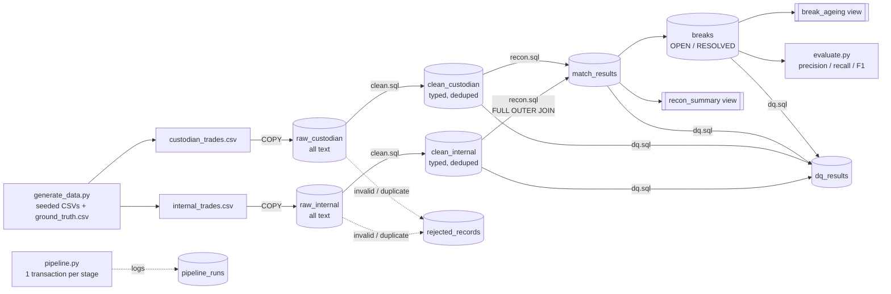

# TradeSync: trade reconciliation pipeline (PostgreSQL + Python)

## The problem
A fund keeps its own record of every trade (the **internal** book). The **custodian** (the bank
that actually holds the securities) sends its own file of the same trades. Every day operations
must prove the two agree. Anything that doesn't is a **break**:

| Break type | Meaning |
|---|---|
| `PRICE_MISMATCH` | both sides have the trade, prices differ by more than the configured tolerance |
| `QUANTITY_MISMATCH` | both sides have the trade, quantities differ |
| `MISSING_IN_CUSTODIAN` | we booked it, the custodian has no record |
| `MISSING_IN_INTERNAL` | the custodian has it, we don't |

TradeSync loads both files into PostgreSQL, cleans and validates them, matches them with a
`FULL OUTER JOIN`, records breaks with their age, runs data-quality checks and logs every run.
All the heavy logic is in plain SQL files in [`sql/`](sql/). Python only orchestrates.

## Architecture


## Quick start
Needs Docker Desktop and Python 3.11+.

```bash
cp .env.example .env
```
(on Windows: `copy .env.example .env`). Edit `.env` and set the same new password in both
`POSTGRES_PASSWORD` and `DATABASE_URL`. Docker reads the first and Python reads the second.
Then run everything with one command.

Windows (PowerShell):
```bash
.\run.ps1
```
Linux / macOS:
```bash
make run
```
Both scripts start Postgres in Docker, install the requirements, generate 100k trades, run the
pipeline and print the evaluation. Other commands: `make test`, `make benchmark`, `make dashboard`, `make down`.

**Demo dashboard (read-only):** after a pipeline run, `python dashboard.py` and open http://127.0.0.1:8000.
It shows the latest batch's match rate, breaks by type, break ageing, recent runs with stage timings,
DQ results, rejection reasons, and a trade lookup across every layer. It is a thin viewer built on
the standard library (`http.server`) with no business logic: every number is a `SELECT` on the
views and tables above. Its DB session is set to read-only. In production this would be a BI tool.
On Windows run them directly, for example `python -m pytest --cov=tradesync`.

Useful options:
```bash
python generate_data.py --size 10000 --seed 1
```
```bash
python -m tradesync.pipeline --as-of 2026-10-31 --batch-id 2026-10-31
```

## Structure
```
config.toml              price tolerance, file paths, generator seed/size
docker-compose.yml       PostgreSQL 16
generate_data.py         synthetic files with seeded breaks + dirty rows + ground_truth.csv
evaluate.py              detected breaks vs ground truth -> precision / recall / F1
benchmark_explain.py     EXPLAIN ANALYZE before/after indexes
dashboard.py             read-only demo web page over the recon tables (stdlib only)
tradesync/
  pipeline.py            stage orchestration, transactions, pipeline_runs, DQ gate
  load_raw.py            COPY -> temp staging -> INSERT ... ON CONFLICT DO NOTHING
  db.py, config.py       connection + SQL file runner, config loading
sql/
  schema.sql             all tables (raw, clean, rejected, recon, runs, dq)
  indexes.sql            extra indexes on trade_id and status
  clean.sql              validation, standardisation, ROW_NUMBER dedup
  recon.sql              FULL OUTER JOIN, break detection, upserts, resolution
  dq.sql                 data-quality checks -> dq_results
  views.sql              break_ageing, recon_summary
tests/                   pytest, every test in its own throwaway Postgres schema
docs/DESIGN_AND_SQL.md   tables, SQL line by line, design decisions, limitations
docs/INTERVIEW_QA.md     40 interview questions answered from this code
```

## Sample output
Output of `python -m tradesync.pipeline` on the 100k dataset (break ageing lines trimmed):
```
Pipeline SUCCESS: run_id=1 batch=2026-10-30 total=6.75s

Pipeline run
  run_id  batch_id    status   raw_int  raw_cust  clean_int  clean_cust  rejected  matched  broken  stage_timings_ms
  1       2026-10-30  SUCCESS  99990    99990     99000      99000       1980      94500    5500    {'clean': 4455, 'recon': 985, 'load_raw': 1111, 'data_quality': 116}

Recon summary
  batch_id    as_of_date  total_trades  matched  broken  match_rate_pct  price_mismatch  quantity_mismatch  missing_in_custodian  missing_in_internal
  2026-10-30  2026-10-30  100000        94500    5500    94.50           2000            1500               1000                  1000

Data quality
  check_name                passed  observed  expected
  breaks_consistent         True    5500      5500
  custodian_rows_reconcile  True    99990     99990
  every_trade_reconciled    True    100000    100000
  internal_rows_reconcile   True    99990     99990
  no_null_keys              True    0         0
  price_positive            True    0         0
  valid_side                True    0         0
```
`python evaluate.py`:
```
break_type                 TP    FP    FN  precision   recall      F1
PRICE_MISMATCH           2000     0     0     1.0000   1.0000  1.0000
QUANTITY_MISMATCH        1500     0     0     1.0000   1.0000  1.0000
MISSING_IN_CUSTODIAN     1000     0     0     1.0000   1.0000  1.0000
MISSING_IN_INTERNAL      1000     0     0     1.0000   1.0000  1.0000
OVERALL                  5500     0     0     1.0000   1.0000  1.0000
```

## Measured results
All numbers come from running this code once on the machine below (31 Oct 2026). Nothing is estimated.

**Machine:** AMD Ryzen 9 9950X3D (16 cores), 61.6 GB RAM, Windows 11 Pro, Python 3.11.9,
PostgreSQL 16.2. *Honest note:* Docker was not installed on the machine used to build this, so
Postgres 16.2 ran as native Windows binaries (from the `pgserver` pip package, used only as a
local server and not a project dependency). `docker-compose.yml` was **not executed** here.
`.\run.ps1 -NoDocker` was run end to end. Timings on Docker will differ.

**CI (GitHub Actions, ubuntu-latest, `postgres:16` service container):** first run passed.
33 tests passed in 2.28 s, 85% coverage, and the 10k smoke run found 550 of 550 seeded breaks with 0 FP and 0 FN.

| Metric | Value |
|---|---|
| Dataset | 100,000 trades; 99,990 rows per file (~6.7 MB each); 5,500 seeded breaks; per file 495 duplicate + 495 corrupted rows to reject, plus a 3% rate of cosmetic dirt (lowercase, spaces) to fix |
| Generate data | 0.83 s |
| Load raw (COPY, both files) | 1,111 ms (fresh database) |
| Clean (validate + dedup, both sides) | 4,455 ms |
| Recon (join + breaks + upserts) | 985 ms |
| Data-quality checks | 116 ms |
| Whole pipeline, fresh DB | 6.75 s |
| Re-run same batch (no new rows) | 5.55 s, table row counts unchanged |
| Rejected rows | 1,980 (990 duplicates, 990 invalid), each with a reason |
| Precision / recall / F1 | 1.0 / 1.0 / 1.0 for all 4 break types (5,500 TP, 0 FP, 0 FN) |
| Tests | 38 passed in 12.1 s (33 pipeline + 5 dashboard) |
| Coverage (pytest-cov) | 85% overall: config/db 100%, load_raw 94%, generate_data 92%, dashboard 86%, evaluate 78%, pipeline 73% (untested lines are the CLI `main()` / printing code) |

**EXPLAIN ANALYZE, before vs after `sql/indexes.sql`** (median of 5 runs, 99,000 clean rows per side,
full plans written to `results/explain_analyze.txt` by `benchmark_explain.py`):

| Query | Before | After | Plan change |
|---|---|---|---|
| Find one trade by `trade_id` | 3.314 ms | 0.015 ms | Seq Scan -> Index Scan |
| Trades that broke in a batch (`batch_id, status`) | 4.409 ms | 0.696 ms | Seq Scan -> Bitmap Index Scan |
| Open breaks by type (`breaks.status`) | 0.625 ms | 0.681 ms | none: still Seq Scan |
| Recon FULL OUTER JOIN | 68.883 ms | 69.949 ms | none: Parallel Hash Full Join both times |

What this shows: indexes help **selective** lookups. They do not help the status filter on `breaks`,
because all 5,500 rows are `OPEN` after one batch, so reading everything is cheaper. They also do
not help the big join, which has to read every row anyway, so a hash join wins.

**Why 1.0 is not a brag:** the generator and the rules were written together, so a perfect score
is the expected result. Its value is as a regression test. If a change to the SQL makes a single
break go missing, or creates a false one (for example the 2,000 seeded "near-miss" prices
inside the tolerance), the score drops below 1.0.
